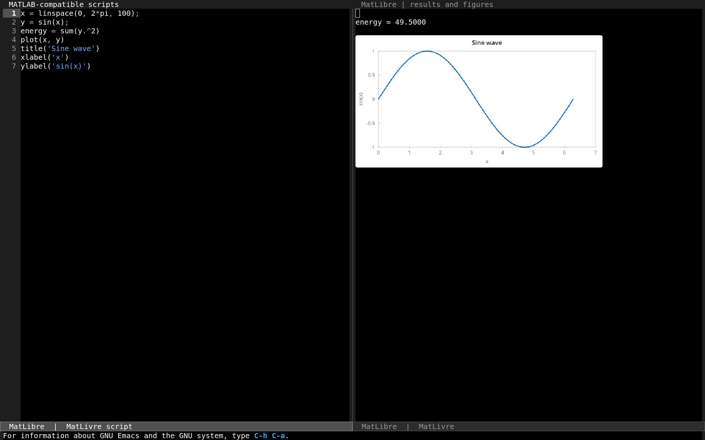
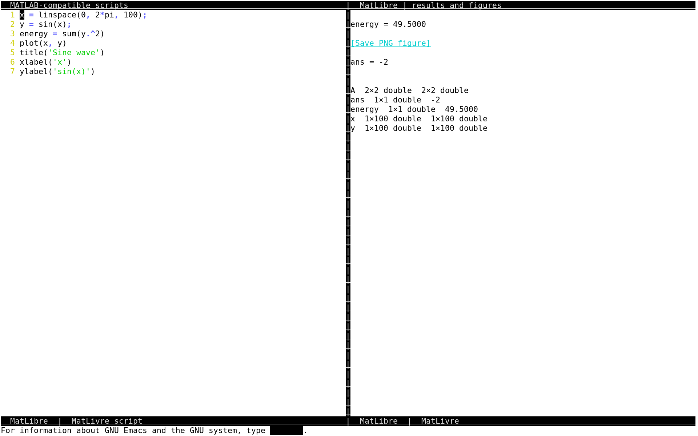

# MatLibre

[Português](README.pt-BR.md)

Run MATLAB-compatible code in Emacs with [MatLivre](https://github.com/campuslivre/matlivre).
MatLibre keeps a workspace alive between evaluations, shows variables and
results in an Emacs buffer, and displays plots inline in graphical Emacs.
In `emacs -nw`, figures have a button to save the PNG.

MatLibre is an independent Emacs integration. MatLivre supplies the language
runtime and its graphical live-script editor. The native MatLivre window opens
separately when you need `.mlx` documents or its document tools.

## Screenshots

Graphical Emacs runs the script and displays the PNG plot. Terminal Emacs
shows numerical output, variables and a button to save the figure.





## Install

Emacs 27.1 or newer and MatLivre with its `--mcp` interface are required.
There are no additional Emacs packages to download.

With GNU Guix, from this checkout:

```sh
guix install -L . -f package
```

The recipe installs `emacs-matlibre` and propagates `matlivre` 0.1.9. It adapts
the official Linux AppImage and builds a private GNU libc 2.43 dependency;
your system libc stays under the control of your system configuration.
The recipes currently support `x86_64-linux`.

Load the library in your Emacs init:

```elisp
(require 'matlivre)
;; Set this only if MatLivre is absent from Emacs's PATH:
;; (setq matlivre-program "/path/to/matlivre")
```

For a manual installation, add the checkout's `lisp` directory to `load-path`
first:

```elisp
(add-to-list 'load-path "/path/to/matlibre/lisp")
(require 'matlivre)
```

Start a terminal session with `emacs -nw`, then run `M-x matlibre`. With a Guix profile, make sure Emacs sees that profile's site-lisp
subdirectories. See [installation and usage](docs/usage.md) for details.

## A quick session

Open a `.m` file, run `M-x matlivre-script-mode`, and press `C-c C-c` to
execute the buffer. Try `a=40`, then evaluate `a+2`: the second evaluation sees
the variable from the first. `C-c C-w` lists variables. `M-x matlibre` returns
to the results window, where `e` opens a prompt for another expression.

| In a script buffer | Action |
| --- | --- |
| `C-c C-c` | Run the buffer, including unsaved edits |
| `C-c C-r` | Run the selected region |
| `C-c C-w` | Inspect the workspace |
| `C-c C-z` | Open the results window |
| `C-c C-o` | Open a document in MatLivre's graphical editor |

In the results window, use `e` to evaluate code, `w` to inspect variables,
`t` to discover upstream tools, and `k` to disconnect. The script mode derives
from built-in Octave mode; it does not take over your existing `.m` file associations.

`examples/waves.m` provides a short plotting example.

## What to expect

The local stdio connection uses `matlivre --mcp`. If a MatLivre window is
already open, upstream connects to that window; otherwise it creates a headless
workspace. Restart the connection after opening or closing the native app.
Headless sessions offer execution and variable inspection. An open native window
also exposes document tools through `M-x matlivre-tool`, with JSON arguments.

Scripts run with your account's permissions. Evaluate trusted code only.
Relative paths use the directory where the connection started. Set `cd`
explicitly when your work needs another directory. Binary `.mlx` files open
in the native editor rather than being evaluated as text.

Guix package builds do not by themselves make public binary substitutes
available. [Packaging notes](docs/packaging.md) explain the runtime dependency
and build-farm requirements.

## Development

```sh
make compile
MATLIVRE_PROGRAM=/path/to/matlivre make test
```

The ERT suite uses the real runtime to check persistent variables, errors,
PNG output, buffers, regions, tool discovery and figure rendering or saving.
Set `MATLIVRE_GUI_TESTS=1` under a working graphical display to include the
native document-window test. GUI and terminal checks use actual Emacs frames.

## License

MatLibre is GPL-3.0-or-later. MatLivre is a separate MIT-licensed project.
The Guix recipe preserves MatLivre's license and bundled font notices.
