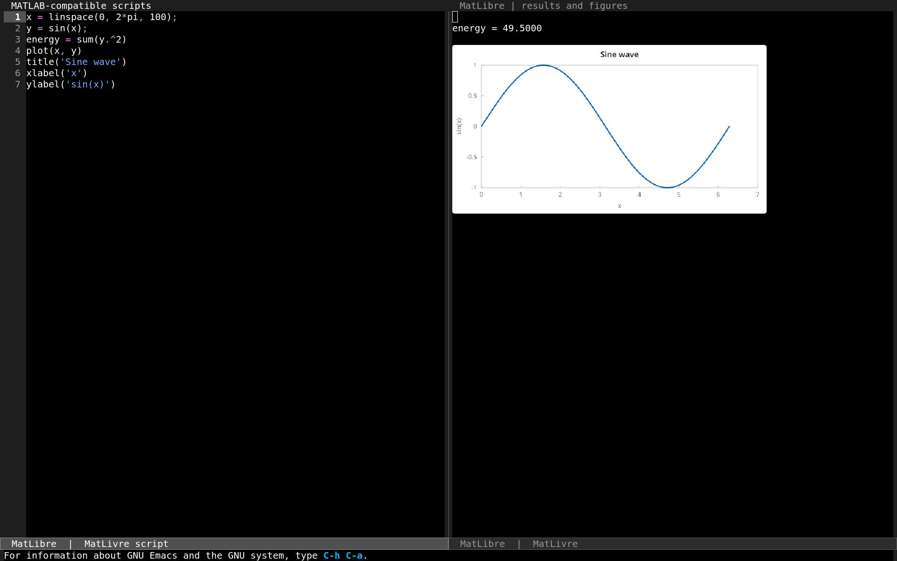
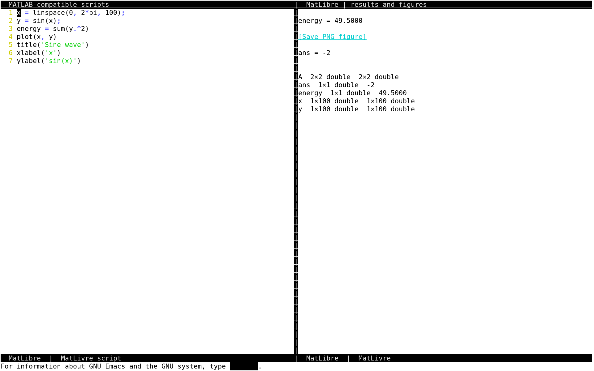

# MatLibre

[English](README.md)

Execute código compatível com MATLAB no Emacs usando o
[MatLivre](https://github.com/campuslivre/matlivre). O MatLibre mantém as
variáveis entre execuções, mostra os resultados em um buffer e exibe gráficos
no Emacs gráfico. No `emacs -nw`, cada figura tem um botão para salvar o PNG.

O MatLibre é uma integração independente. O MatLivre fornece o interpretador
e seu editor de live scripts. A janela nativa abre separadamente quando você
precisa trabalhar com documentos `.mlx` ou usar suas ferramentas de documentos.

## Capturas de tela

O Emacs gráfico executa o script e exibe o PNG. No terminal, o Emacs
mostra resultados numéricos, variáveis e um botão para salvar a figura.





## Instalação

É necessário ter Emacs 27.1 ou mais recente e MatLivre com a interface `--mcp`.
A integração usa apenas bibliotecas que já acompanham o Emacs.

Com GNU Guix, neste checkout:

```sh
guix install -L . -f package
```

A receita instala `emacs-matlibre` e propaga `matlivre` 0.1.9. O aplicativo vem
do AppImage oficial, adaptado para o Guix, com uma GNU libc 2.43 privada como
dependência. A libc do sistema continua sob o controle da configuração do sistema.
As receitas atualmente suportam `x86_64-linux`.

Adicione ao seu arquivo de inicialização do Emacs:

```elisp
(require 'matlivre)
;; Configure somente se o MatLivre não estiver no PATH do Emacs:
;; (setq matlivre-program "/caminho/para/matlivre")
```

Na instalação manual, adicione antes o diretório `lisp` deste projeto ao
`load-path`:

```elisp
(add-to-list 'load-path "/caminho/para/matlibre/lisp")
(require 'matlivre)
```

Para usar no terminal, abra `emacs -nw` e execute `M-x matlibre`. Com um perfil Guix, verifique se o Emacs encontra os subdiretórios
de `share/emacs/site-lisp`. Veja o [guia de uso](docs/usage.pt-BR.md).

## Primeira sessão

Abra um arquivo `.m`, execute `M-x matlivre-script-mode` e pressione `C-c C-c`
para executar o buffer. Avalie `a=40` e, depois, `a+2`: a variável continua no
workspace. `C-c C-w` mostra as variáveis. `M-x matlibre` abre os resultados;
nesse buffer, a tecla `e` permite avaliar outra expressão.

| No buffer do script | Ação |
| --- | --- |
| `C-c C-c` | Executar o buffer, incluindo alterações não salvas |
| `C-c C-r` | Executar a região selecionada |
| `C-c C-w` | Inspecionar o workspace |
| `C-c C-z` | Abrir a janela de resultados |
| `C-c C-o` | Abrir um documento no editor gráfico do MatLivre |

Na janela de resultados, `e` avalia código, `w` mostra variáveis, `t` descobre
ferramentas disponíveis e `k` encerra a conexão. O modo de edição deriva do
Octave mode e preserva as associações que você já usa para arquivos `.m`.
O arquivo `examples/waves.m` contém um exemplo curto com gráfico.

## Funcionamento e limites

A conexão local usa `matlivre --mcp`. Se uma janela do MatLivre já estiver
aberta, o programa se conecta a ela; caso contrário, cria um workspace sem
janela. Reinicie a conexão depois de abrir ou fechar o aplicativo nativo.
A sessão sem janela oferece execução de código e inspeção de variáveis.
Com uma janela aberta, `M-x matlivre-tool` também oferece ferramentas de
documentos, que recebem argumentos em JSON.

O código executa com as permissões da sua conta. Execute somente código
confiável. Caminhos relativos usam o diretório em que a conexão começou;
use `cd` explicitamente quando necessário. Documentos binários `.mlx` abrem
no editor nativo, sem serem avaliados como texto pelo Emacs.

Um build bem-sucedido no Guix não publica automaticamente substitutos binários.
A [documentação de empacotamento](docs/packaging.md) descreve os requisitos
do runtime e da buildfarm.

## Desenvolvimento

```sh
make compile
MATLIVRE_PROGRAM=/caminho/para/matlivre make test
```

Os testes ERT usam o interpretador real para verificar persistência de
variáveis, erros, PNG, buffers, regiões, descoberta de ferramentas e exibição
ou salvamento de figuras. Defina `MATLIVRE_GUI_TESTS=1` em um ambiente gráfico
para incluir a verificação da janela nativa e de suas ferramentas de documentos.

## Licença

O MatLibre usa GPL-3.0-or-later. O MatLivre é um projeto separado sob licença MIT.
A receita Guix preserva a licença do MatLivre e os avisos das fontes incluídas.
